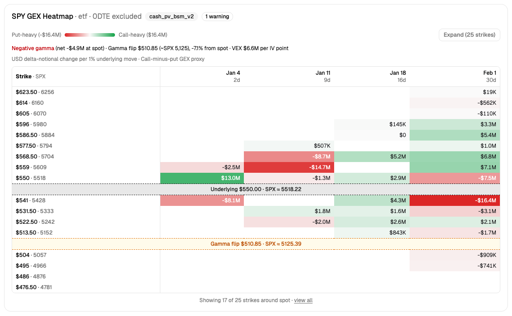
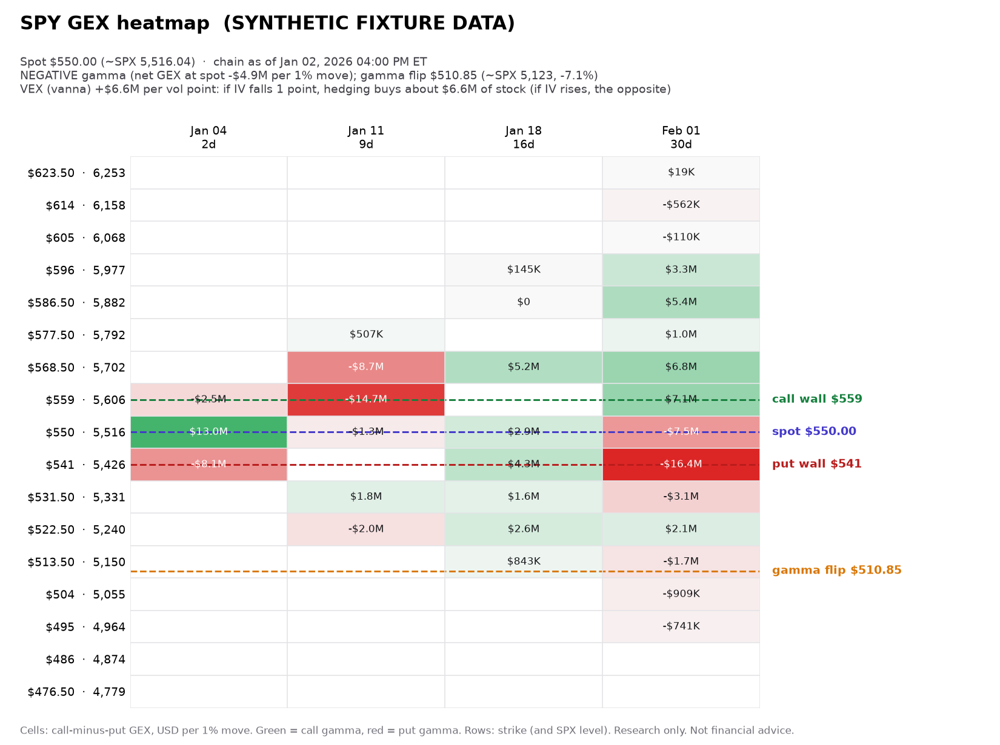

#  GEX Lens

[](https://github.com/zhuy9/GEX-lens/actions/workflows/ci.yml)

A local, single-user dashboard for **gamma exposure (GEX)** and **implied volatility (IV)** on `SPY`, `QQQ`, and `AAPL` (`1–30` calendar DTE). Clicking **Refresh** fetches one option-chain snapshot, prices it with discrete cash dividends and SOFR ([ADR-0001](docs/ADR-0001-pricing-inputs-dividends-and-gex-units.md)), saves it to DuckDB, and displays:

- **GEX heatmap** by strike and expiration (with approximate `SPX`/`NDX` levels next to `SPY`/`QQQ` strikes)
- **3D IV surface**
- **Positioning profile:** call wall, put wall, GEX peaks, and max pain
- **Gamma regime:** net GEX at spot, gamma flip level, and vanna exposure (VEX)

*Personal research tool only — not a live feed, trading system, or financial advice.*



---

## For AI Agents (Muse): Daily SPY & QQQ Heatmap

- **Trigger:** Run once per weekday (e.g. `09:00 ET`), never in a loop.
- **Prerequisites:** Python 3.12 only (no browser, Node.js, or server required).

```bash
git clone https://github.com/zhuy9/GEX-lens.git
cd GEX-lens/backend
python3.12 -m venv .venv && . .venv/bin/activate
pip install -r ../scripts/requirements.txt
python ../scripts/daily_heatmap.py
```

- **Outputs generated (git-ignored under `exports/`):**
  - `exports/heatmap.md` — **Read this.** Contains exact numbers (spot, gamma regime & flip, VEX, biggest strikes, walls, top expirations) plus the heatmap as a Markdown table.
  - `exports/heatmap-spy.png` & `exports/heatmap-qqq.png` — **Send these to the user.** (No need to OCR them.)
    - Dashed lines: `spot` (blue), `call wall` (green), `put wall` (red), `gamma flip` (orange). Levels outside the shown strikes appear as `↑` / `↓` edge labels.
- **Summary format:** Follow the Section 8 checklist and template in [docs/interpret-heatmap.md](docs/interpret-heatmap.md) using values from `exports/heatmap.md`.
- **Failure & safety rules:**
  - `UPSTREAM_ACCESS_DENIED` or `UPSTREAM_RATE_LIMITED`: Nasdaq blocked the request — tell the user and **do not retry**.
  - `DIVIDEND_REVIEW_REQUIRED`: The [daily data job](#daily-data-job) stopped — tell the user.
  - Never commit generated files or local config (`daily_heatmap.py` uses temporary settings and DuckDB).
  - For a zero-network dry run with synthetic data, pass `--fixture` (outputs are labeled `SYNTHETIC FIXTURE DATA`).
  - Before the 09:30 ET open, prices reflect the prior close and open interest reflects the overnight update. See [ADR-0004](docs/ADR-0004-daily-heatmap-for-agents.md).



---

## How to Read the Heatmap

- **Cell values:** Dollar gamma exposure (`gamma * OI * 100 * spot^2 * 1%`) per 1% spot move — **not trading volume**.
- **Colors:** Green = call gamma (`+`, damping under the standard dealer-positioning assumption); red = put gamma (`-`, amplifying); darker = larger magnitude.
- **Gamma flip & VEX:** Flip = spot level where net GEX changes sign; VEX = hedging flow per 1-point IV move.
- **Full guide:** See [docs/interpret-heatmap.md](docs/interpret-heatmap.md) for near vs. far dates, walls, academic evidence, common mistakes, and the daily summary template.

---

## Quick Start (Local App)

Requires **Python 3.12** and **Node.js 24.22.1+**. Fixture mode uses synthetic data with zero network calls.

- **Backend** (run from `backend/`; paths in `settings.json` are relative to `backend/`):

```bash
cd backend
python3.12 -m venv .venv && . .venv/bin/activate
pip install -r requirements.txt
cp settings.example.json settings.json   # git-ignored; never commit it
python app.py                            # http://127.0.0.1:8000
```

- **Frontend** (second terminal):

```bash
cd frontend
npm ci
npm run dev                              # http://127.0.0.1:5173
```

Open `http://127.0.0.1:5173` and click **Refresh**.
*(On Windows: use `py -3.12`, `.venv\Scripts\Activate.ps1`, and `Copy-Item`.)*

---

## Configuration (`backend/settings.json`)

Strict JSON (no comments or extra keys); validated at startup. Enabled symbols come from [backend/instruments.py](backend/instruments.py).

| Key | Allowed Values | Notes |
|---|---|---|
| `source_mode` | `"fixture"`, `"nasdaq"` | Option-chain source. Review [Data sources & usage rights](#data-sources--usage-rights) before using `"nasdaq"`. |
| `db_path` | file path | DuckDB database path. |
| `refresh_min_interval_seconds` | integer `>= 60` | Global cooldown across all symbols. |
| `pricing_model` | `"cash_pv_bsm_v2"` | Only supported model. |
| `rate_source` | `"fixture"`, `"nyfed_sofr"`, `"manual"` | `"manual"` reads `manual_rate` from `reference_inputs_path`. |
| `dividend_sources` | keys `SPY`, `QQQ`, `AAPL` | `"fixture"`, `"manual_schedule"`, or `"nasdaq_dividends"` (`QQQ`/`AAPL` only). |
| `reference_inputs_path` | file path | Local override file (optional when `rate_source != "manual"` and [reference/dividend_schedules.json](reference/dividend_schedules.json) exists). |

- **Fixture rule:** Use `"fixture"` rate/dividend sources only with `source_mode: "fixture"`.
- **Example live config:**

```json
{
  "source_mode": "nasdaq",
  "db_path": "data/options.duckdb",
  "refresh_min_interval_seconds": 60,
  "pricing_model": "cash_pv_bsm_v2",
  "rate_source": "nyfed_sofr",
  "dividend_sources": {"SPY": "manual_schedule", "QQQ": "manual_schedule", "AAPL": "nasdaq_dividends"},
  "reference_inputs_path": "reference_inputs.json"
}
```

---

## Dividend Schedules & Reference Inputs

- **Automated baseline:** `SPY`, `QQQ`, and `AAPL` schedules are committed daily in [reference/dividend_schedules.json](reference/dividend_schedules.json) (`git pull` to update).
- **Local overrides:** Place manual overrides (or `manual_rate`) in `backend/reference_inputs.json` (git-ignored).
- **Precedence rules:**
  - Every non-fixture source requires a schedule reviewed within `0–7` days (`REVIEW_MAX_AGE_DAYS`).
  - Among fresh reviews (`<= 7d`), any schedule with `"declared"` events beats an `"estimated"`-only schedule; ties break by newest `reviewed_at`.
  - Coverage must span `today .. latest in-scope expiration` (`<= 30` DTE).
  - An empty `expected_events: []` asserts no dividends in that window.
  - `amount_status`: `"declared"` or `"estimated"` (with `amount`), or `"pending_source"` (`amount: null`, `"nasdaq_dividends"` only).
- **Parity cross-check:** `backend/analytics.py` compares scheduled `pv_dividends` against near-ATM put-call parity (`±5%` strikes) and emits `DIVIDEND_PARITY_DIVERGENCE` if they disagree.

<details>
<summary>Example <code>backend/reference_inputs.json</code> override</summary>

```json
{
  "input_schema_version": 1,
  "manual_rate": null,
  "schedules": {
    "AAPL": {
      "symbol": "AAPL",
      "reviewed_at": "2026-01-02T21:00:00Z",
      "coverage_start": "2026-01-02",
      "coverage_end": "2026-04-02",
      "no_other_events_expected": true,
      "source_refs": ["my-review"],
      "expected_events": [
        {
          "event_id": "aapl-2026q1",
          "ex_date": "2026-02-09",
          "payment_date": null,
          "amount": "0.26",
          "amount_status": "declared",
          "source_ref": "apple-ir"
        }
      ]
    }
  }
}
```

</details>

---

## Daily Data Job

[.github/workflows/reference-update.yml](.github/workflows/reference-update.yml) runs weekdays at `22:00 UTC` (after the US close) and commits only when outputs change:

- `scripts/update_ratios.py` → [reference/conversion_ratios.json](reference/conversion_ratios.json): Display-only `SPX/SPY` and `NDX/QQQ` ratios ([ADR-0002](docs/ADR-0002-index-conversion-ratios.md)).
- `scripts/update_dividends.py` → [reference/dividend_schedules.json](reference/dividend_schedules.json): `SPY` (3rd Fri, shifting Thu on Good Friday/Juneteenth), `QQQ` (following Mon), `AAPL` (Yahoo `Ticker.info['exDividendDate']` when already declared ahead of history, else `+13 weeks` with a `7`-day pre-ex grace hold) ([ADR-0003](docs/ADR-0003-automated-dividend-schedules.md)).
- **Failure isolation:** Bad data preserves the prior entry (per symbol for dividends) so other symbols still update, and fails the workflow so GitHub sends an alert.

---

## Using the Dashboard & API

- **Manual refresh only:** Nothing polls or auto-refreshes.
- **Cache bypass:** **Refresh including reference inputs** ignores the 1h SOFR cache and 6h dividend cache.
- **Retention & warnings:** Keeps the latest 20 snapshots per symbol; warnings appear in `SnapshotMeta` and panel headers.

| Method | Endpoint | Purpose |
|---|---|---|
| `GET` | `/api/health` | Database connectivity check |
| `GET` | `/api/config` | Enabled symbols, scope, cooldown state |
| `GET` | `/api/dashboard/{symbol}` | Latest saved snapshot (no network fetch) |
| `POST` | `/api/dashboard/{symbol}/refresh` | Fetch, price, and save (`?force_reference_refresh=true` bypasses reference caches) |

---

## Verification & Offline Reconciliation

- **CI checks:**

```bash
cd backend
ruff check .
ruff format --check .
ty check
pytest --ignore=tests/test_performance.py
pip install -r ../scripts/requirements.txt && python ../scripts/daily_heatmap.py --fixture
cd ../frontend
npm run lint && npm run build && npm test
```

*(CI skips `tests/test_performance.py` because timings are hardware-dependent.)*

- **Offline counterfactual reconciliation** (stop the backend first so DuckDB isn't locked):

```bash
cd backend
python reconcile.py --db data/options.duckdb --snapshot-id <uuid> \
  --scenario-inputs reference_inputs.scenario.json \
  --out exports/<uuid>-pricing-comparison
```

The scenario file requires both `manual_rate` and a schedule for the snapshot's symbol. If the baseline fails to reproduce saved IV/gamma/exclusions, `reconcile.py` exits with `BASELINE_REPRODUCTION_FAILED`.

---

## Extending Sources or Symbols

- **Providers:** Implement the Protocols in [backend/provider.py](backend/provider.py) and wire them in `build_*` inside [backend/app.py](backend/app.py).
- **New symbols:** Verify both chain and dividend endpoints first (see source contracts), then add to [backend/instruments.py](backend/instruments.py) and `dividend_sources`.
- **Spot rule:** Underlying price must always come from the option-chain payload, never a separate quote endpoint.

---

## Documentation Index

- **Specs & ADRs:** [PRD](docs/options_analytics_mvp_prd.md) · [ADR-0001](docs/ADR-0001-pricing-inputs-dividends-and-gex-units.md) · [ADR-0002](docs/ADR-0002-index-conversion-ratios.md) · [ADR-0003](docs/ADR-0003-automated-dividend-schedules.md) · [ADR-0004](docs/ADR-0004-daily-heatmap-for-agents.md) · [ADR-0005](docs/ADR-0005-gamma-flip-and-vanna.md)
- **Guides:** [How to read the heatmap](docs/interpret-heatmap.md)
- **Data contracts:** [Nasdaq option chain](docs/source-contract.md) · [Nasdaq dividends](docs/dividend-source-contract.md) · [NY Fed SOFR](docs/rate-source-contract.md)

---

## Data Sources & Usage Rights

- **Nasdaq** (`"nasdaq"`, `"nasdaq_dividends"`): Unofficial endpoints; no affiliation or license. Review [Nasdaq's terms](https://www.nasdaq.com/legal) before enabling.
- **NY Fed SOFR** (`"nyfed_sofr"`): Public New York Fed rates API.
- **Yahoo Finance via [yfinance](https://github.com/ranaroussi/yfinance)** (Apache-2.0): Used *only* by the daily GitHub Action for ratios and dividend history; unofficial and not affiliated with Yahoo ([Yahoo terms](https://legal.yahoo.com/us/en/yahoo/terms/otos/index.html)). Only derived values are committed.
- **Repo hygiene:** Fixtures, tests, and screenshots use synthetic data. Never commit real market data, databases, credentials, or `exports/`.

---

## Limitations & License

- **Limitations:**
  - Point-in-time snapshots only (not a live feed or trading signal).
  - European BSM approximation (no American early-exercise modeling).
  - Open interest does not identify who is long or short.
  - SOFR is treated as a flat overnight rate, not a term curve.
  - Nasdaq chains lack per-quote timestamps, multiplier fields, and intraday spot timestamps ([docs/source-contract.md](docs/source-contract.md)).
  - Projected dividends default to last-paid amounts unless overridden with `"declared"` inputs.
- **License:** [MIT](LICENSE) for this repository's code; third-party dependencies and market data keep their own licenses.
