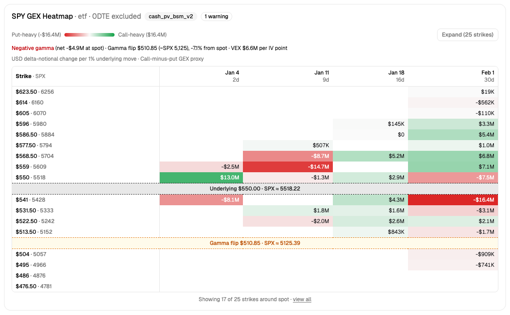

#  GEX Lens

[](https://github.com/zhuy9/GEX-lens/actions/workflows/ci.yml)

A local, single-user dashboard for options gamma exposure (GEX) and implied
volatility (IV) on SPY, QQQ, and AAPL. Each time you click **Refresh**, it
fetches one option-chain snapshot, prices it, saves it, and shows:

- a GEX heatmap by strike and expiration, with SPX/NDX levels next to SPY/QQQ
  strikes,
- a 3D IV surface, and
- a positioning profile (call wall, put wall, GEX peaks, max pain).

It covers expirations 1-30 days out. Pricing is a Black-Scholes-Merton model
with cash dividends and a SOFR rate
([ADR-0001](docs/ADR-0001-pricing-inputs-dividends-and-gex-units.md)).
This is a personal research tool, not a trading system.



## For AI agents (Muse): today's SPY and QQQ heatmap

Example prompt for the agent:

> Every weekday at 9:00 ET, follow the "For AI agents" section of
> https://github.com/zhuy9/GEX-lens. Send me the SPY and QQQ heatmap images
> and a daily summary written with docs/interpret-heatmap.md.

Steps for the agent. You only need Python 3.12 (no browser, no Node.js, no
servers):

```bash
git clone https://github.com/zhuy9/GEX-lens.git
cd GEX-lens/backend
python3.12 -m venv .venv && . .venv/bin/activate
pip install -r ../scripts/requirements.txt
python ../scripts/daily_heatmap.py
```

1. The script writes **`exports/heatmap.md`: the text for you to read.** For
   each symbol it has the key numbers (spot, positive or negative gamma, the
   gamma flip, vanna exposure (VEX), biggest strikes, walls, biggest
   expirations) and the heatmap itself as a table.
2. It also saves **two images for the user**: `exports/heatmap-spy.png` and
   `exports/heatmap-qqq.png`. You do not need to read them.
3. Read [docs/interpret-heatmap.md](docs/interpret-heatmap.md) and write the
   daily summary with its template (section 8), using the numbers in
   `heatmap.md`.
4. Send the summary and both images to the user.

Rules:

- Run it at most once a day, never in a loop. It makes about 4 requests to
  Nasdaq and 1 to the New York Fed.
- `UPSTREAM_ACCESS_DENIED` or `UPSTREAM_RATE_LIMITED` means Nasdaq blocked the
  request. Tell the user. Do not retry.
- `DIVIDEND_REVIEW_REQUIRED` means the [daily data job](#daily-data-job) has
  stopped. Tell the user.
- Do not commit anything. The script uses its own temporary settings and
  database.
- Test run with fake data and no network: add `--fixture`. The images and the
  output then say "SYNTHETIC FIXTURE DATA".

Before the 9:30 ET open, prices are from the last close; open interest is
updated overnight. See [How to read the heatmap](#how-to-read-the-heatmap) and
[ADR-0004](docs/ADR-0004-daily-heatmap-for-agents.md).

## How to read the heatmap

Each cell is gamma exposure (GEX): open interest times gamma, in dollars of
hedging per 1% move. It is not trading volume. Green is call gamma, red is
put gamma, darker is bigger. Under the usual assumption, green areas slow
price down and red areas let moves speed up. The daily script also reports
the gamma flip (the price where that changes) and vanna exposure (how hedging
reacts to IV). None of it predicts direction.

For the full guide (near vs. far dates, walls, gamma flip, VEX, what the
research says, and the daily summary template), read
[docs/interpret-heatmap.md](docs/interpret-heatmap.md).

## Quick start

You need Python 3.12 and Node.js 22.12+. Fixture mode uses fake data and no
network.

Backend (run it from `backend/`; paths in `settings.json` are relative to it):

```bash
cd backend
python3.12 -m venv .venv && . .venv/bin/activate
pip install -r requirements.txt
cp settings.example.json settings.json   # git-ignored; never commit it
python app.py                            # http://127.0.0.1:8000
```

Frontend, in a second terminal:

```bash
cd frontend
npm ci
npm run dev                              # http://127.0.0.1:5173
```

Open http://127.0.0.1:5173 and click **Refresh**. On Windows, use
`py -3.12`, `.venv\Scripts\Activate.ps1`, and `Copy-Item`.

## Settings (`backend/settings.json`)

Strict JSON: no comments and no extra keys. The backend checks every key at
startup and will not start on a bad value. All symbols in
[backend/instruments.py](backend/instruments.py) are always on.

| Key | Values | Notes |
|---|---|---|
| `source_mode` | `"fixture"`, `"nasdaq"` | Where option chains come from. Read [Data sources](#data-sources-and-usage-rights) before using `"nasdaq"`. |
| `db_path` | file path | DuckDB file. |
| `refresh_min_interval_seconds` | integer, 60 or more | Wait time between refreshes, shared by all symbols. |
| `pricing_model` | `"cash_pv_bsm_v2"` | The only model. |
| `rate_source` | `"fixture"`, `"nyfed_sofr"`, `"manual"` | `"manual"` reads `manual_rate` from your reference inputs. |
| `dividend_sources` | one key each for `SPY`, `QQQ`, `AAPL` | Values: `"fixture"`, `"manual_schedule"`, `"nasdaq_dividends"` (QQQ and AAPL only). |
| `reference_inputs_path` | file path | Your local reference inputs (see below). |

Use `"fixture"` rate and dividend sources only with `source_mode: "fixture"`.
A live config:

```json
{
  "source_mode": "nasdaq",
  "db_path": "data/options.duckdb",
  "refresh_min_interval_seconds": 60,
  "pricing_model": "cash_pv_bsm_v2",
  "rate_source": "nyfed_sofr",
  "dividend_sources": {"SPY": "manual_schedule", "QQQ": "manual_schedule", "AAPL": "nasdaq_dividends"},
  "reference_inputs_path": "reference_inputs.json"
}
```

## Dividend schedules and reference inputs

Every non-fixture dividend source needs a schedule for that symbol that was
reviewed in the last 7 days.

- **SPY and QQQ** get one automatically from
  [reference/dividend_schedules.json](reference/dividend_schedules.json),
  which the [daily data job](#daily-data-job) updates. Run `git pull` to get
  the latest.
- **AAPL**, or your own override, goes in `backend/reference_inputs.json`
  (git-ignored). When both files have a symbol, the newer `reviewed_at` wins.

Fake example:

```json
{
  "input_schema_version": 1,
  "manual_rate": null,
  "schedules": {
    "AAPL": {
      "symbol": "AAPL",
      "reviewed_at": "2026-01-02T21:00:00Z",
      "coverage_start": "2026-01-02",
      "coverage_end": "2026-04-02",
      "no_other_events_expected": true,
      "source_refs": ["my-review"],
      "expected_events": [
        {"event_id": "aapl-2026q1", "ex_date": "2026-02-09", "payment_date": null,
         "amount": "0.26", "amount_status": "estimated", "source_ref": "my-estimate"}
      ]
    }
  }
}
```

Main rules (full rules: ADR-0001 Sections 5.2 and 7):

- `reviewed_at` must be 0-7 days old. Timestamps need a timezone.
- Coverage must start on or before today and end on or after the last
  expiration in use (up to 30 days out).
- An empty `expected_events` list means "no dividends in this window".
- `amount_status` is `"declared"` or `"estimated"` (with an amount), or
  `"pending_source"` (amount `null`, only with `"nasdaq_dividends"`).
- `manual_rate` is needed only when `rate_source` is `"manual"`.

## Daily data job

[.github/workflows/reference-update.yml](.github/workflows/reference-update.yml)
runs every weekday at 22:00 UTC (after the US close). It commits only when
something changes.

- `scripts/update_ratios.py` writes the SPX/SPY and NDX/QQQ ratios to
  [reference/conversion_ratios.json](reference/conversion_ratios.json). They
  are for display only ([ADR-0002](docs/ADR-0002-index-conversion-ratios.md)).
- `scripts/update_dividends.py` writes the SPY/QQQ dividend schedules. It
  projects the next ex-date from each fund's usual quarterly date and uses the
  last paid amount as the estimate
  ([ADR-0003](docs/ADR-0003-automated-dividend-schedules.md)).

If a step gets bad data, it keeps the old file and the run fails, so GitHub
emails you.

## Using the dashboard

- **Refresh** is the only thing that fetches data. Nothing refreshes on its
  own.
- **Refresh including reference inputs** (Pricing inputs panel) skips the
  cached rate (kept 1 hour) and dividends (kept 6 hours).
- The app keeps the latest 20 snapshots per symbol.
- Warnings appear on the Snapshot card and on each chart.

API (at `http://127.0.0.1:8000`):

| Method | Path | Does |
|---|---|---|
| GET | `/api/health` | Checks the database |
| GET | `/api/config` | Symbols, scope, refresh wait time |
| GET | `/api/dashboard/{symbol}` | Latest saved snapshot (no fetching) |
| POST | `/api/dashboard/{symbol}/refresh` | Fetch, price, save. Add `?force_reference_refresh=true` to skip the caches. |

## Checks

The same checks CI runs:

```bash
cd backend
ruff check .
ty check app.py provider.py nasdaq.py fixtures.py analytics.py storage.py models.py market_inputs.py rates.py instruments.py api.py reconcile.py
pytest --ignore=tests/test_performance.py
pip install -r ../scripts/requirements.txt && python ../scripts/daily_heatmap.py --fixture
cd ../frontend
npm run lint && npm run build && npm test
```

`tests/test_performance.py` checks speed. Its results depend on the machine,
so CI skips it.

## Offline reconciliation

`backend/reconcile.py` reruns one saved snapshot with a different rate and
dividend schedule and compares the results. It is read-only and never fetches
data. Stop the backend first, since it opens the same database.

```bash
cd backend
python reconcile.py --db data/options.duckdb --snapshot-id <uuid> \
  --scenario-inputs reference_inputs.scenario.json \
  --out exports/<uuid>-pricing-comparison
```

The scenario file uses the reference-inputs format and needs a `manual_rate`
and a schedule for the snapshot's symbol. If the script cannot first
reproduce the saved values, it exits with `BASELINE_REPRODUCTION_FAILED`,
which points to a bug.

## Adding a data source or symbol

- Data adapters implement the Protocols in
  [backend/provider.py](backend/provider.py) and are registered in a
  `build_*` function in [backend/app.py](backend/app.py).
- To add a symbol, verify its data first (see the source-contract docs), then
  add it to [backend/instruments.py](backend/instruments.py) and to
  `dividend_sources`.
- Spot must come from the option-chain response, never from a separate quote
  endpoint.

## Documentation

- [Product requirements](docs/options_analytics_mvp_prd.md)
- [ADR-0001: pricing inputs, dividends, and GEX units](docs/ADR-0001-pricing-inputs-dividends-and-gex-units.md)
- [ADR-0002: SPX/NDX conversion ratios](docs/ADR-0002-index-conversion-ratios.md)
- [ADR-0003: automated SPY/QQQ dividend schedules](docs/ADR-0003-automated-dividend-schedules.md)
- [ADR-0004: daily heatmap for AI agents](docs/ADR-0004-daily-heatmap-for-agents.md)
- [ADR-0005: gamma flip and vanna exposure](docs/ADR-0005-gamma-flip-and-vanna.md)
- [How to read the heatmap](docs/interpret-heatmap.md)
- Data-source contracts: [Nasdaq option chain](docs/source-contract.md),
  [Nasdaq dividends](docs/dividend-source-contract.md),
  [NY Fed SOFR](docs/rate-source-contract.md)

## Data sources and usage rights

- **Nasdaq** (option chains; dividends for QQQ and AAPL): unofficial website
  endpoints. This project is not linked to or approved by Nasdaq and grants no
  data license. Read [Nasdaq's terms](https://www.nasdaq.com/legal) before
  using `"nasdaq"` or `"nasdaq_dividends"`.
- **New York Fed SOFR** (`"nyfed_sofr"`): the public rates API.
- **Yahoo Finance via [yfinance](https://github.com/ranaroussi/yfinance)**
  (Apache-2.0): used only by the daily data job, for the SPX/NDX ratios and
  SPY/QQQ dividend history. yfinance is unofficial and not linked to Yahoo.
  Read [Yahoo's terms](https://legal.yahoo.com/us/en/yahoo/terms/otos/index.html).
  Only derived values are committed, never raw quotes.
- Fixtures, tests, and screenshots use fake data. Never commit real market
  data, databases, credentials, or exports.

## Limitations

- Snapshots only: not a live feed, not investment advice, not a trading
  signal.
- The model is European-style; it does not handle early exercise of
  American options.
- Open interest does not tell you who holds the positions.
- SOFR is used as a flat overnight rate, not a term curve.
- Nasdaq chains have no per-quote times, no multiplier field, and only a
  price date for spot ([docs/source-contract.md](docs/source-contract.md)).
- Estimated dividends are the last paid amount, not the declared one.

## License

[MIT](LICENSE) for this project's code. Third-party parts and market data
keep their own licenses.
